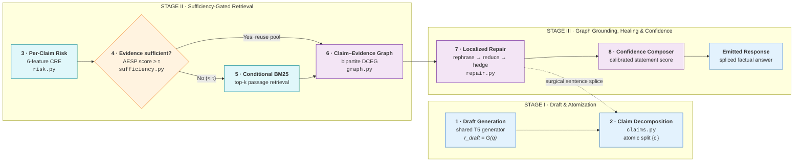
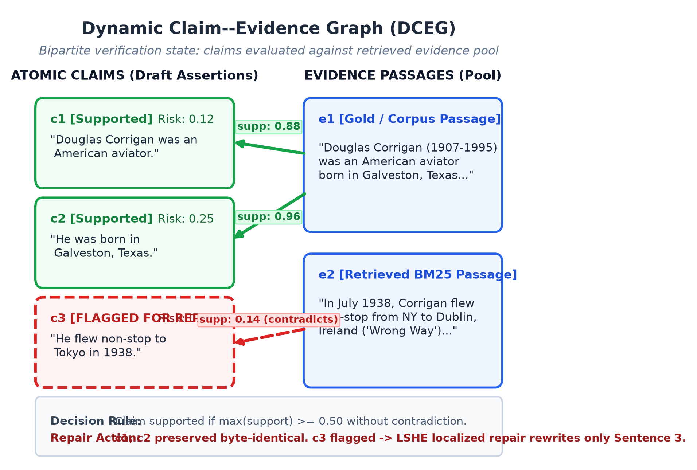
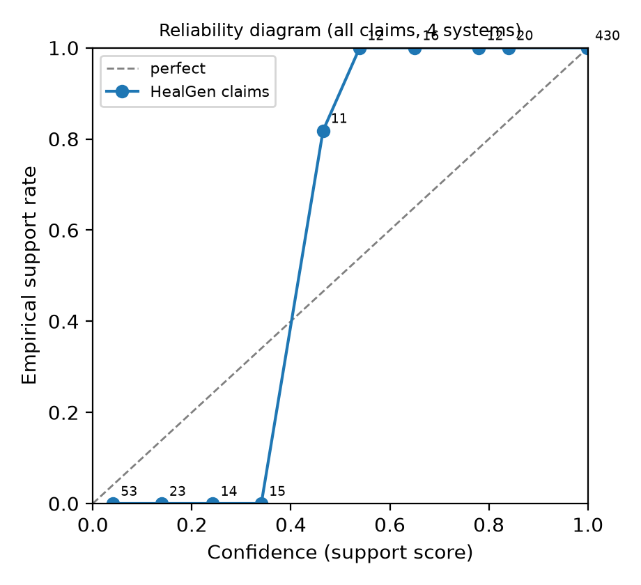
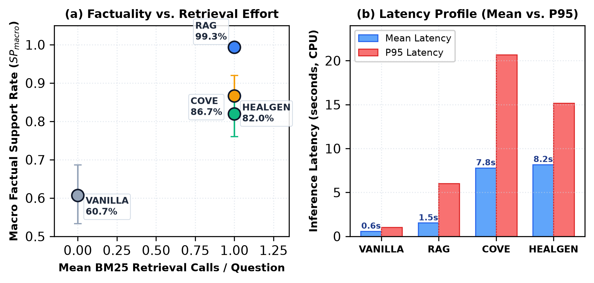

<div align="center">

# ⚕️ HealGen

### Claim-Level Evidence-Sufficiency-Guided Self-Healing Inference for Factual LLM Generation

**A draft-first inference architecture that trusts, retrieves, or surgically repairs — one atomic claim at a time.**

[](paper/main.pdf)
[](#-quickstart)
[](#-reproducing-the-results)
[](#-design-parameters)
[](LICENSE)
[](paper/SUBMISSION.md)

**N = 150** HaluEval-QA · **flan-t5-base** · frozen shared-pool protocol · paired bootstrap, 2000 resamples

</div>

---

## 📜 Abstract

Large language models hallucinate factual claims, and existing remedies either retrieve for every question or verify only after the fact. **HealGen** is a draft-first self-healing architecture that decides, *per atomic claim*, whether to **trust** it, **retrieve** evidence for it, or **repair** it locally — driven by a claim-level risk estimator, an evidence-sufficiency predictor gating retrieval, a dynamic claim–evidence graph, and localized repair, all validated against a single NLI judge.

We pair the architecture with an evaluation protocol designed to make such claims *checkable*:

- **Frozen shared pools** — every system is scored against one shared pool per question (gold knowledge ∪ the union of all four systems' passages), so no system's retrievals are private evidence.
- **Gold-only condition** — a second scoring pass against the gold passage alone, separating gold-grounded support from retrieval-overlap credit.
- **A pre-registered judge gate** — the judge must pass a validation threshold *before* any benchmark run, and is then frozen.
- **Emitted-answer scoring** — the judge scores what the system *emits*, never private intermediate state.

> **Honest headline.** On this benchmark, always-on RAG is the strongest system on factual support (SP<sub>macro</sub> = 0.993) because HaluEval-QA answers are short and extractive. HealGen reaches SP<sub>macro</sub> = **0.820** — significantly above vanilla generation (Δ = +0.213, Holm *p* < .001), significantly below RAG (Δ = −0.173, Holm *p* < .001), and **not resolved** against CoVe (Δ = −0.047, Holm *p* = .203). The contribution we defend is the **measurement protocol** and a working self-healing architecture under it — not a claim of record-setting performance.

---

## 🎯 Why HealGen?

Three established paradigms each address a *different stage* of generation — and each leaves a gap:

| Paradigm | Stage | Failure mode |
|---|---|---|
| **Pre-generation retrieval** (standard RAG) | Before answering | Queries unconditionally for *every* prompt; adds latency; can still misinterpret passages |
| **Post-generation verification** (FActScore, SAFE) | After answering | Detects the error but **does not repair it** |
| **Monolithic revision** (CoVe, Self-Refine) | After answering | Rewrites the *entire* response — wasteful, and frequently introduces new hallucinations |

**What is missing** is an inference architecture that unifies these stages around a *shared, persistent claim state* — enabling surgical, sentence-level repair without full-text regeneration.

### Three core principles

| # | Principle | What it means |
|---|---|---|
| 1️⃣ | **Draft-First Decomposition** | Generate an unconstrained draft *first*, then parse it into atomic claims — so verification operates on what the model *actually asserted*, not on speculative query hypotheses |
| 2️⃣ | **Sufficiency-Gated Retrieval** | Query external evidence only when the Adaptive Evidence Sufficiency Predictor finds available evidence inadequate (`score < τ`) — isolating retrieval to uncertain claims |
| 3️⃣ | **Sentence-Localized Splice** | Repair *only the specific sentences* owning unsupported claims; verified sentences pass through **100% byte-identical** |

---

## 🏗️ Architecture

HealGen runs a closed inference loop in three stages, as implemented in [`prototype/healgen/`](prototype/healgen/):



### The localized-splice invariant

> **Sentences owning *supported* claims pass through 100% byte-identical.**
>
> Only sentences producing *unsupported* claims are rewritten by the Localized Self-Healing Engine (**LSHE**): `rephrase` against the evidence pool → `reduce_confidence` hedge → `express_uncertainty`. The persistent claim–evidence graph (DCEG), rather than monolithic text generation, governs the unit of truth.

### Worked example: the aviator query

Given the question *"Where was aviator Douglas Corrigan born, and what was his famous 1938 flight?"*, the loop proceeds:

| Step | Module | Output |
|---|---|---|
| **1** Draft | `generator.py` | *"Douglas Corrigan was an American aviator. He was born in Galveston, Texas. In 1938, he flew non-stop to Tokyo."* |
| **2** Decompose | `claims.py` | → `c₁` aviator · `c₂` born in Galveston · `c₃` flew to Tokyo |
| **3** Risk | `risk.py` | `c₁` 0.12 · `c₂` 0.25 · `c₃` **0.89** (novel entity "Tokyo") |
| **4–5** Gate + retrieve | `sufficiency.py` | pool empty → `score = 0.0 < τ` → BM25 retrieves `e₂` (the *Dublin* flight) |
| **6** Graph | `graph.py` | `e₁→c₁` **0.88** ✓ · `e₁→c₂` **0.96** ✓ · `e₂→c₃` **0.14** ✗ contradiction |
| **7** Repair | `repair.py` | Sentence 3 rewritten → *"In July 1938, he flew non-stop from New York to Dublin, Ireland."* — **Sentences 1 & 2 byte-identical** |
| **8** Compose | — | Final answer + statement confidences `(0.88, 0.96, 0.85)` |

<div align="center">

<br/>
<sub><b>Figure 1.</b> The Dynamic Claim–Evidence Graph (DCEG) exported by <code>healgen/graph.py</code>. Bipartite links connect atomic claims to evidence passages with NLI support scores. <code>c₁</code> and <code>c₂</code> meet the support threshold (≥ 0.50) and pass through untouched; <code>c₃</code> receives 0.14 (contradiction with the Dublin flight) and is flagged for localized repair.</sub>
</div>

---

## 📊 Results

All values below are **generated** from committed experiment outputs by [`make_tables.py`](prototype/experiments/make_tables.py) — never hand-typed. See [`paper/tables/`](paper/tables/) for the LaTeX source of every table.

### Main benchmark — N = 150 HaluEval-QA test questions

| System | SP<sub>macro</sub> [95% CI] | SP<sub>micro</sub> | SP<sub>gold</sub> | HR | Any-HR | EM | F₁ | ECE |
|:---|:---:|:---:|:---:|:---:|:---:|:---:|:---:|:---:|
| Vanilla | 0.607 [0.533, 0.687] | 0.607 | 0.260 | 0.393 | 0.393 | 0.140 | 0.194 | 0.121 |
| RAG | 0.993 [0.980, 1.000] | 0.993 | 0.913 | 0.007 | 0.007 | 0.773 | 0.841 | 0.016 |
| CoVe | 0.867 [0.813, 0.920] | 0.867 | 0.353 | 0.133 | 0.133 | 0.187 | 0.230 | 0.060 |
| **HealGen** ✨ | **0.820** [0.760, 0.880] | **0.827** | **0.307** | **0.173** | **0.180** | 0.140 | 0.188 | **0.040** |

**Reading the columns**

- **SP** — Support Rate under the frozen shared-pool protocol; the judge credits a claim if it is supported by *any* passage in the shared pool. **SP<sub>gold</sub>** re-scores against the gold passage *only*, removing retrieval-overlap credit.
- **HR / Any-HR** — hallucination rate over claims / fraction of answers with ≥ 1 unsupported claim. Lower is better.
- **EM / F₁** — judge-free exact match and F₁ against the gold answer.
- **ECE** — expected calibration error of claim-level confidences.

> **The gold-only condition separates the systems sharply.** RAG retains almost all of its support (0.913 of 0.993) because it extracts the retrieved — usually gold — passage nearly verbatim. CoVe (0.353), HealGen (0.307), and vanilla (0.260) drop to the bottom third: HealGen's localized repair *rephrases* claims into hedge or summary form that the lexical branch does not credit against gold alone. Read together, the two conditions say HealGen's support is real but **partly retrieval-overlap-mediated**, and its output is more abstractive than RAG's extractive answers.

### Significance — paired bootstrap, Holm-corrected over 6 comparisons

| Comparison (SP<sub>macro</sub>) | Δ | 95% CI | Holm *p* |
|:---|:---:|:---:|:---:|
| HealGen vs Vanilla | **+0.213** | [0.140, 0.287] | < .001 ✱ |
| HealGen vs RAG | −0.173 | [−0.240, −0.113] | < .001 ✱ |
| HealGen vs CoVe | −0.047 | [−0.113, 0.020] | .203 |
| CoVe vs RAG | −0.127 | [−0.180, −0.073] | < .001 ✱ |
| CoVe vs Vanilla | +0.260 | [0.180, 0.340] | < .001 ✱ |
| RAG vs Vanilla | +0.387 | [0.307, 0.467] | < .001 ✱ |

✱ Holm *p* < .05. Five of six comparisons resolve. **The HealGen–CoVe gap does not** — its CI includes zero and at N = 150 the test is underpowered for a gap of this size, so we report it as *not resolved*, **not** as a tie.

### Efficiency — cost of inference-time verification

| System | BM25 calls (mean) | Latency mean (s) | p50 (s) | p95 (s) | Abstain |
|:---|:---:|:---:|:---:|:---:|:---:|
| Vanilla | 0.0 | 0.59 | 0.52 | 1.01 | 0.0 |
| RAG | 1.0 | 1.53 | 0.99 | 6.03 | 0.0 |
| CoVe | 1.0 | 7.80 | 8.20 | **20.67** | 0.0 |
| **HealGen** | 1.0 | 8.18 | 8.54 | **15.16** | 0.0 |

HealGen and CoVe are both multi-stage verification architectures, but HealGen maintains a **substantially tighter tail latency** (p95 15.16s vs 20.67s) because its repair operates surgically on individual sentences rather than regenerating the whole response.

### Ablations — which component actually contributes?

| Variant | SP<sub>macro</sub> | Any-HR | EM | F₁ | BM25 calls |
|:---|:---:|:---:|:---:|:---:|:---:|
| **HealGen (full)** | 0.820 | 0.180 | 0.140 | 0.188 | 1.0 |
| w/o CRE (uniform risk) | 0.820 | 0.180 | 0.140 | 0.188 | 1.0 |
| w/o AESP (always retrieve) | 0.820 | 0.180 | 0.140 | 0.188 | 1.0 |
| **w/o LSHE (hedge only)** | **0.620** | **0.380** | 0.140 | 0.189 | 1.0 |

The result is **asymmetric and expected**: disabling CRE or AESP reproduces the full system *exactly*, because on this benchmark both already fire uniformly (every draft claim exceeds the risk threshold; every claim starts against an empty pool). Disabling **LSHE** costs 0.200 SP<sub>macro</sub> and more than doubles Any-HR at unchanged EM — **localized repair is the only component this benchmark can measure**, and it acts purely by making claims more supportable, not more gold-exact.

### Judge validation gate — measured *before* the benchmark ran

| Role | Model | Accuracy | AUC | n |
|:---|:---|:---:|:---:|:---:|
| Primary (frozen) | DeBERTa-v3-base-mnli-fever-anli | 0.83 | 0.9895 | 200 |
| Secondary | nli-deberta-v3-small | 0.85 | 0.9878 | 200 |

### Sufficiency threshold sensitivity (τ, 50-question dev split)

| τ | Precision | Recall | F₁ | Accuracy | Selected |
|:---:|:---:|:---:|:---:|:---:|:---:|
| **0.3** | 0.556 | 0.597 | **0.576** | 0.617 | ✅ (full sweep) |
| 0.5 | 0.511 | 0.358 | 0.421 | 0.571 | — |
| 0.7 | 0.455 | 0.075 | 0.128 | 0.558 | — (used in committed run) |

> **Disclosed process artifact.** The committed test run used τ = 0.7 from an earlier *partial* sweep, while the full 154-pair sweep selects 0.3. This is **inert on this benchmark** — single-claim drafts are tested against an initially empty pool, so no τ in the grid can change any decision — but we disclose it rather than silently reconcile it.

---

## 🖼️ Figures

<div align="center">
<table>
<tr>
<td align="center" width="50%">
<br/>
<sub><b>Figure 2.</b> Calibration diagnostic over all emitted claims. Top: empirical support vs predicted confidence tracking the ideal <i>y = x</i> diagonal (<b>ECE = 0.040</b>) with no post-hoc temperature scaling. Bottom: log-scale claim counts — <b>430 of 606</b> claims sit in the [0.9, 1.0] bin at near-100% support.</sub>
</td>
<td align="center" width="50%">
<br/>
<sub><b>Figure 3.</b> Cost and efficiency profiles. <b>(a)</b> Factuality–retrieval Pareto frontier: SP<sub>macro</sub> vs mean BM25 calls per question. <b>(b)</b> End-to-end CPU latency (mean and P95) for inference-time decomposition and verification.</sub>
</td>
</tr>
</table>
</div>

---

## 📁 Repository Structure

```
verigen/
├── paper/                          # 📄 IEEEtran manuscript (source of truth)
│   ├── main.tex                    #    preamble + generated headline macros
│   ├── sections/                   #    intro · related · architecture · method
│   │                               #    experiments · results · limitations · conclusion
│   ├── tables/                     #    ⚠️ GENERATED by make_tables.py — never hand-edit
│   ├── figures/                    #    ⚠️ GENERATED figures
│   ├── refs.bib                    #    bibliography
│   ├── SUBMISSION.md               #    arXiv submission kit + honesty invariants
│   └── main.pdf                    #    locally built PDF
│
├── prototype/                      # 🔬 The executable research artifact
│   ├── healgen/                    #    the architecture, one module per stage
│   │   ├── claims.py               #    2 · atomic claim decomposition
│   │   ├── risk.py                 #    3 · Claim Risk Estimator (6-feature CRE)
│   │   ├── sufficiency.py          #    4 · Adaptive Evidence Sufficiency Predictor
│   │   ├── graph.py                #    6 · Dynamic Claim–Evidence Graph (DCEG)
│   │   ├── repair.py               #    7 · Localized Self-Healing Engine (LSHE)
│   │   ├── judge.py                #    validated NLI judge + frozen pools
│   │   ├── systems.py              #    vanilla / RAG / CoVe / HealGen baselines
│   │   ├── metrics.py · rescore.py #    SP, EM/F₁, calibration, gold-only condition
│   │   └── config.py               #    ⚠️ pinned experiment contract (no env/network)
│   ├── experiments/                #    every run in the paper, as a script
│   │   ├── run_main.py             #    main benchmark (N=150)
│   │   ├── run_ablations.py        #    component ablations
│   │   ├── run_judge_validation.py #    pre-registered judge gate
│   │   ├── tune_tau.py             #    τ sweep
│   │   ├── train_cre.py            #    CRE logistic regression
│   │   └── make_tables.py          #    results/*.csv → paper/tables/*.tex
│   ├── results/                    #    ✅ committed raw outputs (CSV / JSONL)
│   └── tests/                      #    85 unit tests
│
├── research/                       # 📚 design notebook
│   ├── 01-prior-art.md · 02-differentiation.md
│   └── 03-eval-methodology.md · 04-arxiv-mechanics.md
│
└── paper/figures/ …                # shared figure assets
```

**Three rules keep this repository honest**

1. **Numbers come from `results/*.csv`, never from prose.** `make_tables.py` regenerates every table and headline macro; `main.tex` inputs them.
2. **`config.py` is the experiment contract.** It reads no environment and no network. Changing a value there invalidates the recorded numbers.
3. **`tables/` and `figures/` are generated artifacts.** Hand-edits are overwritten on the next run.

---

## 🚀 Quickstart

### Requirements

- **Python 3.10+** (developed and tested on 3.14)
- **CPU is enough** — no GPU, no API keys, no paid services
- ~2 GB disk for cached Hugging Face models

```bash
git clone https://github.com/princekumar-dev/HealGen.git
cd HealGen/prototype
pip install -r requirements.txt
```

### Run the test suite

```bash
cd prototype
python -m pytest -q          # 85 passed in ~2.5 min
```

> Some tests are marked `slow` — they download and run local Hugging Face models (minutes, not seconds). Deselect with `-m "not slow"` for a fast pass.

### Run a smoke test first

```bash
python experiments/run_smoke.py --n 5 --model small
```

Downloads `flan-t5-small` and runs 5 questions end-to-end through all four systems — a fast way to confirm your environment works before committing to the full run.

---

## 🔁 Reproducing the Results

> ⚠️ **These runs are slow on CPU.** The full pipeline takes hours, not minutes. Every committed result in this repository can be regenerated from scratch with the sequence below.

```powershell
# 0 · from the repository root
cd prototype

# 1 · pre-registered judge gate — MUST pass before any benchmark run
python experiments/run_judge_validation.py

# 2 · train the Claim Risk Estimator on disjoint data
python experiments/train_cre.py

# 3 · tune the sufficiency threshold τ on the 50-question dev split
python experiments/tune_tau.py

# 4 · main benchmark, N = 150, flan-t5-base
python experiments/run_main.py --n 150 --model base

# 5 · component ablations (paired against the same frozen pools)
python experiments/run_ablations.py --n 150

# 6 · regenerate every table + figure + headline macro in paper/
python experiments/make_tables.py

# 7 · rebuild the manuscript
cd ..
& .\.tools\tectonic.exe --keep-logs paper\main.tex
& .\.tools\tectonic.exe --keep-logs --keep-intermediates paper\main.tex
Copy-Item paper\main.pdf paper\healgen-arxiv.pdf
```

**Verify you got the same numbers:**

```bash
grep -E "SP|ECE" prototype/results/system_summary.csv
```

| Expected (`system_summary.csv`) | Value |
|:---|:---:|
| Vanilla SP<sub>macro</sub> | 0.6067 |
| RAG SP<sub>macro</sub> | 0.9933 |
| CoVe SP<sub>macro</sub> | 0.8667 |
| HealGen SP<sub>macro</sub> | 0.8200 |
| HealGen ECE | 0.0402 |

---

## 🔬 Evaluation Protocol

The protocol is the paper's primary contribution. Four rules make self-healing claims **checkable** rather than circular:

| # | Rule | Why it exists |
|---|---|---|
| 1 | **Frozen shared pools** | Each question gets one pool = gold knowledge ∪ the union of *all four* systems' retrieved passages. No system's retrievals are private evidence, so a system cannot score well merely by retrieving a lot |
| 2 | **Gold-only condition** | A second scoring pass against the gold passage alone, bounding how much of a system's support is retrieval-overlap credit |
| 3 | **Pre-registered judge gate** | The judge must clear a validation threshold on 100 labeled contrast pairs *before* any benchmark run; it is then frozen for the run |
| 4 | **Emitted-answer scoring** | The judge scores the *emitted* answer, never private intermediate state — internal confidence is not evidence |

**Statistical design**

- **Paired** across systems: every system answers the *same* questions against the *same* pools.
- **Paired bootstrap** confidence intervals, 2000 resamples.
- **Holm–Bonferroni** correction across the 6 pairwise comparisons.
- Null results are reported as *"not resolved at this N"*, never as equivalence.

---

## ⚙️ Design Parameters

All pinned in [`prototype/healgen/config.py`](prototype/healgen/config.py) — this file is the experiment contract.

| Parameter | Value | Notes |
|:---|:---|:---|
| Test split | N = 150, seed 42 | never resampled |
| Dev split | N = 50, seed 43 | for τ selection |
| Judge gate | 100 pairs, seed 44 | pre-registered |
| Generator | `google/flan-t5-base` | frozen, never fine-tuned |
| Judge | `DeBERTa-v3-base-mnli-fever-anli` | frozen after gate |
| Embedder | `all-MiniLM-L6-v2` | for CRE + AESP |
| Retriever | Okapi BM25, k₁=1.5, b=0.75 | top-k = 3 |
| Sufficiency τ | 0.7 (committed run) | full sweep selects 0.3 — see disclosure |
| Max new tokens | 64 | short-answer benchmark |

---

## ⚠️ Limitations

We state these plainly; each traces to a committed artifact.

1. **The benchmark collapses the selective gate.** HaluEval-QA answers are ≤ 8 words and almost always a single atomic claim, so CRE flagged *every* draft claim and AESP judged *every* claim insufficient: HealGen retrieved exactly once per question and never exercised its skip-retrieval branch or multi-claim graph. That machinery is **implemented and unit-tested but not stressed** by this benchmark. A long-form benchmark (FaithDial, long-form factuality sets) is the natural next test.
2. **Support rule uses lexical overlap.** The hybrid rule (substring *or* NLI entailment) can over-credit surface overlap; the gold-only column partially controls for this but pure-NLI scoring remains stricter and is reported as sensitivity, not headline.
3. **Judge quality is measured, not assumed.** The primary judge clears the gate (acc 0.83, AUC 0.9895) but is far from perfect — all verdicts are instrument readings of one model.
4. **No temperature scaling (T = 1 throughout).** ECE/Brier values are calibration of an *unfitted* instrument, not a calibrated probability claim.
5. **Statistical power.** At N = 150 only the larger gaps resolve. The HealGen–CoVe comparison is underpowered.
6. **Scope.** Short factual questions, a small open generator, BM25 over a 200-paragraph corpus. Nothing here establishes behavior for long-form generation or stronger generators.

---

## 🧩 Four Takeaways for Practitioners

1. **Decompose before verifying.** Monolithic paragraph verification is ambiguous and lossy. Atomic claims enable precise, interpretable error localization.
2. **Distinguish sufficiency from relevance.** A document can be topically relevant while lacking the facts needed to prove an assertion. Gating retrieval on *sufficiency* avoids redundant queries.
3. **Surgically repair — don't monolithically rewrite.** Discarding a whole draft when one sentence is unsupported wastes compute and introduces new errors. Byte-identical splicing preserves verified facts.
4. **Evaluate against shared evidence pools.** All competing systems must be scored against one common frozen pool; private retrievals make claims circular and uncheckable.

---

## 📂 Related Work — Where HealGen Sits

| Line of work | Representatives | Gap HealGen addresses |
|---|---|---|
| Adaptive retrieval | Self-RAG, CRAG, Adaptive-RAG, DRAGIN | None estimate *per-claim hallucination risk* or judge whether evidence is *sufficient* for the specific claim |
| Claim-level factuality | FActScore, SAFE, HALoGEN, FACTOR, SURE-RAG | These *evaluate, rank, or abstain* — they do not retrieve or repair |
| Self-correction & repair | Self-Refine, Reflexion, CoVe, **RARR** | RARR is the closest precedent, but strictly post-hoc: no risk estimate, no sufficiency gate, no confidence output |
| Structured claim–evidence state | ADORE, Enoki | The structure is a *store*, not a live control structure driving retrieval, repair, and confidence simultaneously |

> **Positioning.** Each mechanism has precedent; we claim novelty only for the **integration** — a single closed loop where shared claim state governs every decision. The burden of proof is compositional.

---

## 📚 Citation

If you use HealGen in your research, please cite:

```bibtex
@article{healgen2026,
  title   = {HealGen: Claim-Level Evidence-Sufficiency-Guided Self-Healing
             Inference for Factual LLM Generation},
  author  = {PLACEHOLDER-BYLINE},
  journal = {arXiv preprint},
  year    = {2026},
  note    = {Code, frozen evidence pools, and claim-level verdicts released at
             https://github.com/princekumar-dev/HealGen}
}
```

> **Note.** The byline is intentionally deferred pending the solo-vs-supervisor submission decision (`paper/main.tex`, `PLACEHOLDER-BYLINE`). Replace `PLACEHOLDER-BYLINE` before citing.

---

## 📄 License

Released under the [MIT License](LICENSE).

---

## 🗺️ Roadmap

- [x] Architecture implemented as a closed claim-level control loop
- [x] Pre-registered judge validation gate (passed, judge frozen)
- [x] Main benchmark, N = 150, paired design
- [x] Ablations isolating CRE / AESP / LSHE contributions
- [x] Calibration diagnostics (reliability diagram, ECE, Brier)
- [x] Generated-table pipeline: `results/*.csv` → `paper/tables/*.tex`
- [x] Full IEEEtran manuscript + arXiv submission kit
- [ ] **Human spot-check rating** → Cohen's κ as judge–human agreement
- [ ] Long-form benchmark to exercise selective retrieval + multi-claim DCEG
- [ ] arXiv submission (endorsement pending)

---

<div align="center">
<sub>
<b>HealGen</b> · draft-first · claim-level · evidence-sufficiency-gated · surgically repaired<br/>
Built as a reproducible research artifact — every number traces to a committed file.
</sub>
</div>
